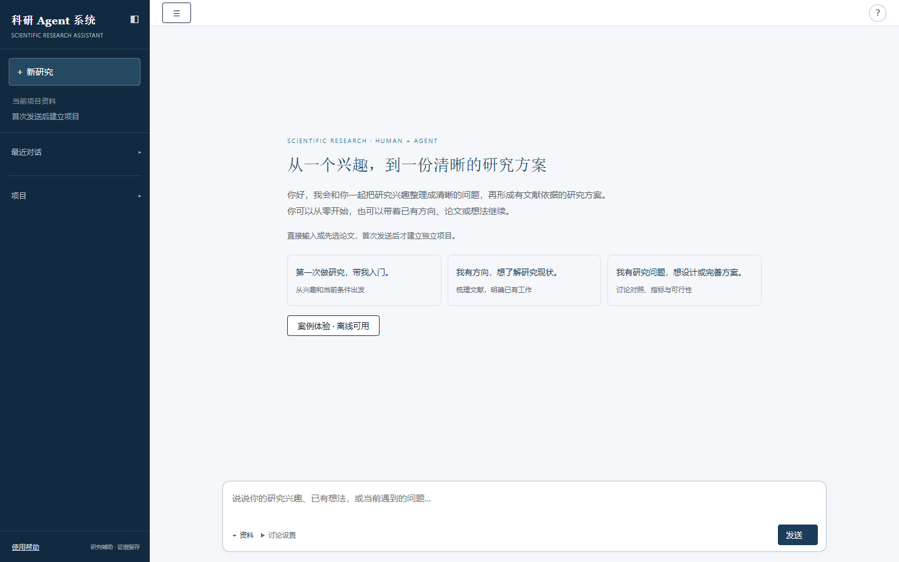

# Scientific Agent · 科研方案工作台

**从一个研究兴趣开始，和 AI 一起读文献、确认问题，形成有依据的研究方案。**

Scientific Agent 是面向理工科研究的 AI 协作工作台。你可以从零开始，也可以带着已有方向、论文或研究问题进入：在中央对话中讨论，把文献、已确认的问题和方案保存在同一个项目中，最终得到一份可审阅、可修改、可导出的研究方案。

它不是“一句话自动写论文”，也不只是文献问答。它关注的是：**读了什么、依据是什么、为什么研究这个问题，以及准备怎样回答它。**

[安装与配置](docs/getting-started.md) · [使用指南](docs/user-guide.md) · [当前版本与边界](docs/current-status.md)



## 你可以怎样使用它

- **第一次做科研**：说明自己的兴趣与条件，选择“带我入门”，逐步理解文献、研究问题和方案之间的关系。
- **已经有方向**：直接探索选题、检索论文，比较已有工作与需要进一步核对的 research gap。
- **已经有论文或问题**：导入资料，从阅读、问题细化或方案设计继续，不必重新走一遍选题。
- **想先体验再开始**：通过联邦学习、硫化物固态电解质两个预置教学案例，离线练习相同的查看、确认、审阅和下载操作。

**当前流程止于研究方案。** 不启动实验或训练，不生成实验结果，也不进入后续论文写作。已有历史材料保留查看和导出。

## 一条有依据的科研路径

```text
明确目标与条件 → 了解研究现状 → 确认研究问题 → 形成并审阅方案
                   ↑                ↑               ↑
                文献与来源       用户明确选择      修改、采纳、导出
```

讨论不是无休止追问。工作台提供选题探索、论文检索与阅读、研究现状与缺口分析、问题确认和方案设计等入口；你决定何时推进，系统调用已有能力并保存实际产物。进入某一步不等于此前步骤已经完成。

| 阶段 | 系统怎样辅助 | 你需要做什么 | 留下什么 |
| --- | --- | --- | --- |
| 明确条件 | 梳理兴趣、已有基础与资源约束，不确定的条件保留待确认 | 说明目标，选择合适范围 | 项目背景、条件与讨论记录 |
| 理解现状 | 有界检索、资料入库、按实际可读范围比较方法与局限 | 查看来源，补充已有材料，核对阅读依据 | 文献库、研究现状报告与待核实缺口 |
| 确认问题 | 根据文献与条件提出有区别的候选问题 | 选择、修改并明确采纳 | 关联来源的正式研究问题 |
| 审阅方案 | 组织方法、验证或论证设计、资源与局限，生成讨论草案 | 审阅、要求修订、明确采纳与下载 | 当前正式方案、历史版本与待确认事项 |

**证据不足不等于发现创新。** 元信息、摘要和正文分别标注；来源失败、成功无结果与筛选排除分别记录。系统不将预期结果写成已取得的结论。

## 对话负责讨论，项目负责保存材料

同一个项目可以有多段独立对话：聊天历史彼此隔离，共享正式问题、方案、文献与研究记录。

- **新研究**：开始独立主题，首次发送才创建项目。
- **在本项目新建对话**：保留项目材料，开启另一段讨论，不混入其他会话聊天历史。
- **研究材料**：从对话打开文献、报告、问题和方案；完整内容在统一阅读面板查看。
- **下载当前产物**：只列已经存在的材料，区分正式方案、未采纳草案与历史版本。
- **笔记**：保存临时想法；未保存输入与正式研究条件分开。

建议不会因为出现在回复里就成为正式材料。采纳需要明确操作；上游问题、条件或文献依据改变后，依赖旧材料的草案会提示复核。失败请求保留输入与已保存材料，可以核对状态后主动重试。

## 不同研究方法，不套同一张模板

| 研究方法 | 方案重点 |
| --- | --- |
| 计算研究 | 数据与任务、基线、公平比较、资源预算、评估和复现条件 |
| 理论研究 | 定义、假设、命题、推导与证明义务、反例和边界条件 |
| 实验研究设计 | 对象、变量、对照、测量、重复与误差、资源与专业审核事项；仅规划 |

当前开放软件工程与计算机系统、AI 与机器学习、计算机安全与隐私、工程与技术、材料科学、物理学、化学、能源和数学九类理工方向。领域不决定研究方法；方向不明确时应先澄清。

这不是临床、人体研究、药物、湿实验或危险操作指导工具。安全研究限公开数据、模拟环境或明确授权范围。

## 例子：从“想做联邦学习”到一份可讨论的方案

> 我第一次做科研，想研究联邦学习中的数据差异，只有普通笔记本，时间大约四周。

先讨论可承受的研究范围，再明确开始检索。论文进入文献库后，围绕实际摘要或可用正文比较 FedAvg、FedProx 等工作的研究对象、方法与条件，而不是直接声称某个方向有创新。

你可以将兴趣逐步收窄为：“在固定训练预算与数据划分下，两种方法对标签分布差异的敏感程度怎样比较？”这只是**候选问题**，仍需结合材料核对，由你确认。

确认后，系统形成方案草案，列出比较条件、评估方法、资源限制、尚未核实的假设与引用。你可以要求缩小范围、修改某部分，再明确采纳、下载，带给导师讨论。

最终得到的是**文献依据＋明确问题＋研究方案**，不是编造的实验结果，也不保证这个示例问题具有创新性。

## 和常见科研工具相比，侧重点在哪里

- **相比通用聊天**：正式材料不埋在聊天记录里；同项目持续协作，建议、确认、修订和复核各有状态。
- **相比单独文献检索／阅读工具**：不止回答“这篇论文说了什么”，还把阅读依据衔接到问题选择与方法设计。
- **相比一键报告或论文生成**：保留研究者的选择权，区分事实、用户条件与待验证设想，不用文档完整度冒充科学有效性。
- **相比单一路径的研究助手**：可从不同阶段进入，支持三类研究方法；新手也能先通过不联网、不调用模型的教学路径学习操作。

这些是产品设计上的侧重点，不是对其他产品的性能排名。Scientific Agent 可以配合专业文献管理器和研究工具使用，不试图替代导师或研究者的学术判断。

## 本地开始使用

准备 Python 3.10+、Git，以及与你的模型路由匹配的服务凭据。前端由后端直接提供，不需要单独构建。

- [自己安装，或交给编程 Agent 安装](docs/getting-started.md)
- [五分钟使用路线、继续项目与失败恢复](docs/user-guide.md)
- [能力边界、验证范围与已知限制](docs/current-status.md)

后端使用 **Python / FastAPI / Pydantic**，通过可配置模型路由连接服务；项目资料和会话保存在 **SQLite＋本地文件目录**，前端为原生 **HTML / CSS / JavaScript**。Agent Harness 将上下文、检索工具、任务状态、来源校验、明确采纳和版本保护组织在同一流程中。

当前适合本地单用户体验。真实生成与文献访问依赖外部服务，可能失败或产生费用；教学标准路径离线可用。尚未完成账号权限、多租户与公网安全交付，请不要直接作为公共服务暴露。
